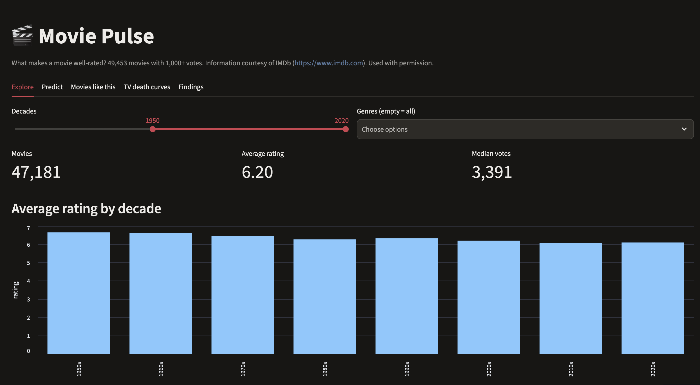
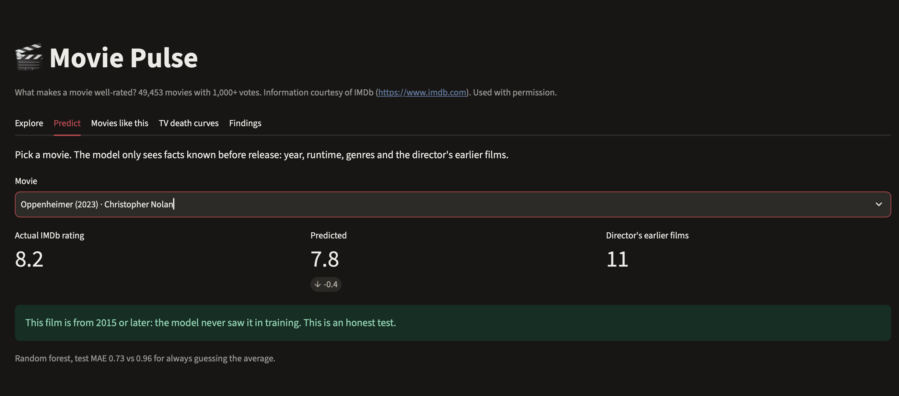
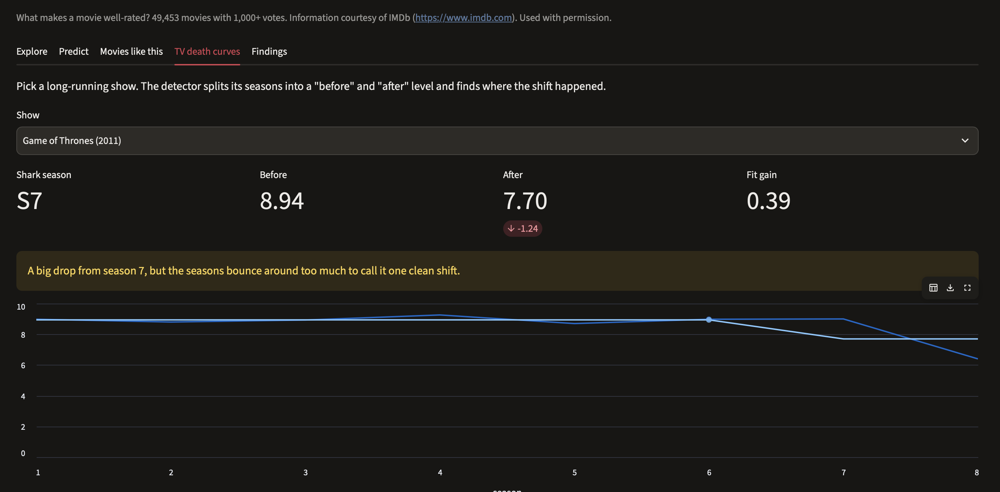

# Movie & TV Pulse

What makes a movie well-rated, and can a model predict it? And for TV: when did a series peak, and which season did it "jump the shark"?

**Short answer:** IMDb ratings follow age, genre, runtime and director more than anything else. A model that uses only facts known before release predicts a movie's rating to within **0.73 stars** on average, 24% better than always guessing the average. On the TV side, **54 of 276** long-running shows had a clear, lasting drop, with Top Gear the biggest.

**Live app:** https://movie-pulse.streamlit.app (works on a phone)

A learning project in data science and ML using IMDb's official non-commercial datasets. For learning and fun only :)

## Data

Information courtesy of IMDb (https://www.imdb.com). Used with permission.

- Source: IMDb's official non-commercial datasets at https://datasets.imdbws.com/. Raw files are not stored in this repo.
- Files used: title.basics, title.ratings, title.crew, title.principals and name.basics for movies; title.episode for TV.
- Movies: non-adult feature films with 1,000+ votes, which leaves **49,453 movies**.
- TV: shows with at least 6 seasons and 25,000+ votes, which leaves **276 long-running shows**.
- What the data doesn't have: plot, budget or box office. The models only see genres, year, runtime and people, so they can't know whether a film is actually good.

## How it works

| Notebook | What it does |
| --- | --- |
| 01_explore | First look at title.basics: size, title types, missing values |
| 02_clean_join | Filters to movies, joins ratings and directors, saves the clean table |
| 03_explore | Ratings by decade, genre, runtime and votes; most consistent directors |
| 04_model | Baseline, linear regression and random forest to predict the rating |
| 05_recommend | "Movies like this" with tag vectors and cosine similarity |
| 06_export | Retrains the final model and writes the small files the app needs |
| 08_tv_death_curves | Season-by-season TV ratings and a "jumped the shark" detector |

The Streamlit app (`app/app.py`) has five tabs: Explore, Predict, Movies like this, TV death curves and Findings. It ships a saved model and trimmed data files (about 12 MB), not the raw IMDb data.

## What I found

1. **Old movies rate higher, but that's partly survivorship bias.** The 1920s average 7.02 and the 2010s 6.07. Only the old films people still watch reach 1,000+ votes today, so the bad ones have dropped out.
2. **Genre matters, and my favourite genres aren't even in the top 3.** Horror is lowest (5.25) and Documentary (7.19) and Biography (6.90) are highest, with Romance comfortably in the middle (6.39). I didn't expect Thriller in the bottom 3 (5.82).
3. **Great directors and consistent directors are not the same.** Christopher Nolan averages 8.18 but isn't in the top 5 most consistent directors. The most consistent ones were names I didn't know.
4. **Longer movies rate higher.** Films over 3 hours average 7.28 against 5.77 for 80 to 90 minutes, but the correlation is only 0.26. That's a correlation, not a recipe: long films tend to be prestige dramas.
5. **More votes go with higher ratings.** Films with 500,000+ votes average 7.76. Popularity follows quality, so the vote count can't be used to predict a rating (that would be leakage).

## Can a model predict the rating?

Trained on films before 2015, tested on films from 2015 on. Splitting by year, not at random, mirrors real life: you predict new films from old ones.

| Model | Test MAE | Note |
| --- | --- | --- |
| Baseline (always guess the average) | 0.961 | The number to beat |
| Linear regression | 0.755 | 21% better than the baseline |
| Random forest | **0.728** | 24% better; needed `min_samples_leaf=20` to stop overfitting |

MAE (mean absolute error) means the forest is off by about 0.73 stars on average. Features: year, runtime, genres and the director's average from earlier films only.

## Movies like this

Each movie is described by tags (genres, decade, director, top 3 cast) and compared with cosine similarity. Rare tags count more (IDF weighting), genres count double, and only films with 20,000+ votes are recommended. Parasite returns five Bong Joon Ho films. Oppenheimer gets documentaries, because the data has no plot.

## When TV shows jump the shark (bonus)

For each long-running show, a change-point detector splits its season averages into a "before" and "after" level. It counts as a shark when the drop is at least 0.5 stars and the split fits clearly better than one flat line (fit gain at least 0.5).

- **54 of 276 shows jumped.** Top Gear fell the furthest: 8.15 to 5.19 from season 23. The Simpsons dropped from 8.06 to 6.75 from season 11.
- **Game of Thrones** fell from 8.94 to 7.70 as expected, but it isn't a clean shark: its fit gain is only 0.39. The crash is really one season (season 8), and the detector needs at least two seasons on each side.
- **Friends** stayed consistent and was slightly better at the end (8.21 to 8.31): no shark, as expected.
- Survivorship bias again: shows cancelled after one or two bad seasons never reach 6 seasons, so they aren't in the 276.

## What I learned

- So much :) Old movies rate higher than current ones partly because only the classics survive.
- Great directors and consistent directors, based on data, are not the same.
- My favourite genres are not even in the top 3. LOL
- The TV results matched what I expected for the shows I love: when they peaked, or whether they stayed consistent.

## Limits and next steps

- **Data:** no plot, budget or box office, and IMDb voters aren't everyone.
- **Model:** biggest misses are review-bombed films and breakout hits the features can't see.
- **Recommender:** only genres, decade, director and cast, and the vote floor adds popularity bias.
- Next: let the detector find a one-season crash like Game of Thrones, and share the feature code between notebooks 04 and 06.

## Run it yourself

    git clone https://github.com/NixAILearn/movie-pulse.git
    cd movie-pulse
    python3 -m venv .venv && source .venv/bin/activate
    pip install -r requirements.txt
    mkdir -p data/raw && cd data/raw
    for f in title.basics title.ratings title.crew title.principals title.episode name.basics; do
      curl -O https://datasets.imdbws.com/$f.tsv.gz
    done
    cd ../..

Then run the notebooks in order (01 to 06, then 08). The downloads are about 1.4 GB. To run the app locally: `streamlit run app/app.py`.

## Progress log
- **Sprint 1: Setup and first look.** Set up the repo, .venv and .gitignore; downloaded IMDb's five official datasets into data/raw/ (not committed).
- Loaded title.basics (millions of rows) with usecols, dtypes and category columns to keep memory down; treated \N as missing.
- Found that TV episodes dominate the file and movies are a small slice, so analysis filters to movies first.
- **Sprint 2: Clean movie table.** Filtered IMDb to non-adult movies, converted years and runtimes to numbers, and joined ratings (kept movies with 1,000+ votes).
- Added each movie's main director with two lookup joins (title.crew, name.basics), checking keys with validate, and one-hot encoded genres.
- Saved 49,453 movies to data/processed/movies.parquet, with a cleaning log of rows kept at each step and the missing-data choices written down.
- **Sprint 3: Exploration and findings.** Explored 49,453 movies: ratings by decade, genre, runtime and votes, plus the most consistent directors.
- Learned groupby, explode, scatter plots, log scales and correlation; set minimum group sizes to avoid small-sample rankings.
- Found that the most consistent directors aren't the highest-rated ones (Nolan averages 8.18 but isn't in the top 5 for consistency), and saw survivorship bias, confounders and a leakage risk (votes) to avoid in Sprint 4.
- **Sprint 4: Rating models.** Predicted IMDb rating from pre-release facts only (year, runtime, genres, director's past average), training on films before 2015 and testing on 2015+.
- Baseline MAE 0.961; linear regression 0.755; random forest 0.728 (24% better). A default deep forest overfit (train 0.25, test 0.77) until min_samples_leaf=20.
- Leakage check: a director average that includes the film itself scored a fake 0.313. Biggest misses are review-bombed films and breakout hits the features can't see.
- **Sprint 5: Recommender.** Built a "movies like this" recommender: each movie is a sparse vector of tags (genres, decade, director, top 3 cast), compared with cosine similarity.
- Version 1 (equal weights) ranked obscure films first, because thin profiles of 3-4 tags match too easily. IDF weighting (rare tags count more), double weight on genres and a 20,000-vote floor fixed it: Parasite now returns five Bong Joon Ho films.
- No answer key, so I sanity-checked by eye and built explain() to show shared tags. Limits: no plot data (Oppenheimer gets documentaries), and the vote floor adds popularity bias.
- **Sprint 6: Streamlit dashboard.** Shipped a live app with four tabs: Explore (decade and genre filters), Predict (actual vs predicted rating), Movies like this, and Findings.
- An export notebook retrains the Sprint 4 forest (test MAE 0.728), saves it with joblib (7.5 MB), and writes trimmed Parquet files (about 5 MB) to app/; raw and processed data stay out of Git. Pinned package versions so the cloud loads the same model.
- Picked movies by tconst instead of title, fixing the duplicate-title bug from Sprint 5, and flagged predictions for pre-2015 films as in-sample (the model trained on them).
- **Sprint 8 (Bonus): TV show death curves.** I had to add something for my beloved TV shows too. Joined title.episode with ratings and show names to chart every season of long-running TV shows.
- Smoothed episode ratings with a rolling mean and wrote a change-point detector that finds the season each show "jumped the shark": 54 of 276 shows did, led by Top Gear. Added a TV death curves tab to the app.
- Learned many-to-one joins with validate, time-series smoothing, change-point detection, and why survivorship bias and noise need a test.
- Checked it against my 2 favourite shows with expected results: Game of Thrones dropped from 8.94 to 7.70 but is too noisy to call a clean shark (fit gain 0.39), and Friends stayed consistent and ended slightly better.
